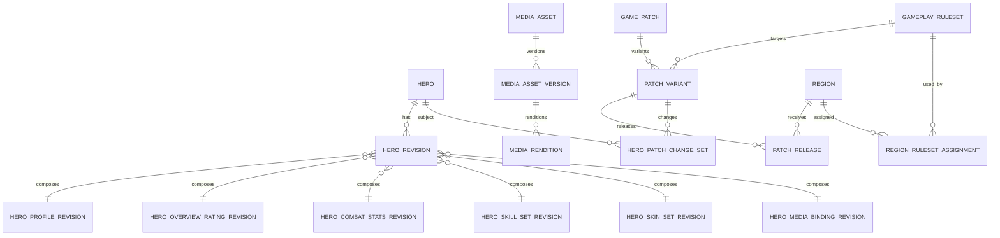

# WikiAOV Backend — Database dự án

**Database:** PostgreSQL  
**Migration:** Flyway  
**Phạm vi:** logical + implementation-oriented schema cho backend hiện hành.  
**Tài liệu liên quan:** `01-BAN-DAC-TA-DU-AN.md`, `03-API-DU-AN.md`


### Migrations domain core đã triển khai

| Migration | Nội dung |
|---|---|
| V005 | ruleset, assignment, patch/translation/variant/release |
| V006 | Hero identity/external identity/composition revision |
| V007 | sáu section, translations, stat values, skill/skin identities và snapshots, effects, media bindings, source refs |
| V008 | Hero change set/summary và các typed STAT/SKILL/ROLE/VISUAL/MECHANIC/OTHER change tables |

V005 sử dụng extension PostgreSQL `btree_gist` để exclusion constraint chặn assignment overlap.
Tài khoản migration cần được phép tạo extension này hoặc DBA provision trước. Không cần extension
cho runtime request. Release có partial unique theo region/effective time; application kiểm tra thứ tự
ordinal không mâu thuẫn timeline trong transaction khóa region.

Section root/composition dùng FK ghép `(section_revision_id, hero_id)` để không compose nhầm Hero.
Published root, section và các row con được bảo vệ bằng trigger; source chỉ được ghi cho DRAFT section.
Change history append-only, không có normal API update/delete. Một draft cho mỗi hero/ruleset bằng
partial unique index. Application khóa Hero identity trước mutation/publish và kiểm tra expected version.

`hero.hero_overview_rating_revision` có thêm version/actor như các section khác. `hero.rating_scale`
seed `GAME_OVERVIEW_10` (0–10) là dictionary nội bộ, không phải seed chỉ số của tướng.
Media refs vẫn là logical ID, không có FK sang media; patch refs được xác minh qua `GameplayContexts`.
Persistence của domain core dùng `JdbcClient`, không tạo JPA relationship xuyên module.

Draft section bị thay bằng snapshot mới có thể thành row không còn composition tham chiếu; chưa purge.
External identity hiện chỉ có schema, chưa có admin API quản lý mapping provider.

---

## 1. Nguyên tắc database

1. Database `wiki` riêng cho `wiki-service`, nhiều PostgreSQL schema theo domain ownership. Có thể chung PostgreSQL instance với service khác (Keycloak, `community-service`) nhưng không chung database và không chung user DB.
2. Entity/repository chỉ thuộc module sở hữu schema đó.
3. Cross-module ID ưu tiên **logical reference**; không tạo cross-schema FK nếu làm module bị coupling sai ownership.
4. Trong cùng module/schema, dùng FK, unique constraint và check constraint mạnh.
5. Published revisions immutable.
6. Draft có optimistic version và concurrency control.
7. Flyway là cơ chế duy nhất thay đổi schema ở môi trường dùng chung.
8. Hibernate không tự `update` schema ở production.
9. UUID là technical ID; `code` là stable readable identifier.
10. `TIMESTAMPTZ` cho thời gian; lưu UTC.

---

## 2. PostgreSQL schemas

```text
hero          Hero identity/revisions/skills/skins/change sets
media         Media asset/version/rendition/upload state
patch         Region/Locale/Ruleset/GamePatch/Variant/Release/index
item          Item catalog/revisions/change sets
arcana        Arcana catalog/revisions/change sets
spell         Spell/phụ trợ catalog/revisions/change sets
enchantment   Enchantment/phù hiệu catalog/revisions/change sets
gamemode      Game mode/system catalog revisions
access        Audit support
user_profile  Hồ sơ dùng chung, module user (ADR-008)
```

`query` module không cần schema riêng nếu read model được dựng động. Nếu sau này materialize projection, có thể tạo schema `projection`; dữ liệu ở đó rebuild được và không phải source of truth.

---

## 3. Shared value concepts

Không tạo `common_entity` table/library. Tuy nhiên các schema dùng chung convention:

### ID

```text
UUID
```

### Stable code

```text
VARCHAR(64/128)
```

quy tắc slug lowercase ASCII, unique theo domain.

### Actor

Các record audit/created-by có:

```text
created_by_issuer
created_by_subject
```

Hồ sơ hiển thị liên kết qua `user_profile.profile`; audit vẫn lưu issuer + subject gốc.

### Revision lifecycle

Thông thường:

```text
DRAFT
PUBLISHED
DISCARDED
```

Published revision không chỉnh content nữa.

---

# PHẦN A — HERO SCHEMA

## 4. `hero.hero`

Stable identity của tướng.

| Column | Type | Rule |
|---|---|---|
| id | UUID | PK |
| code | VARCHAR(64) | NOT NULL UNIQUE, immutable sau public |
| created_at | TIMESTAMPTZ | NOT NULL |
| created_by_issuer | TEXT | NOT NULL |
| created_by_subject | TEXT | NOT NULL |

Không lưu name/stats/ảnh trực tiếp tại đây.

### External identity

`hero.hero_external_identity`

| Column | Type |
|---|---|
| hero_id | UUID |
| provider | VARCHAR(64) |
| namespace | VARCHAR(64) |
| external_value | VARCHAR(255) |

PK/unique phù hợp:

```text
UNIQUE(provider, namespace, external_value)
UNIQUE(hero_id, provider, namespace)
```

---

## 5. `hero.hero_revision`

Composition revision của hero.

| Column | Type | Ý nghĩa |
|---|---|---|
| id | UUID | PK |
| hero_id | UUID | FK hero.hero |
| ruleset_id | UUID | logical ref patch.gameplay_ruleset |
| revision_no | BIGINT | tăng trong `(hero_id,ruleset_id)` |
| state | VARCHAR(16) | DRAFT/PUBLISHED/DISCARDED |
| version | BIGINT | optimistic version của draft |
| publication_sequence | BIGINT NULL | tăng khi publish |
| published_at | TIMESTAMPTZ NULL | thời điểm WikiAOV publish revision |
| cause | VARCHAR(32) | GAME_PATCH / CONTENT_CORRECTION / TRANSLATION / IMPORT_CORRECTION / VISUAL_UPDATE / OTHER |
| source_revision_id | UUID NULL | revision được fork |
| effective_from_patch_variant_id | UUID NULL | logical ref patch.patch_variant |
| profile_revision_id | UUID | section ref |
| overview_rating_revision_id | UUID | section ref |
| combat_stats_revision_id | UUID | section ref |
| skills_revision_id | UUID | section ref |
| skins_revision_id | UUID | section ref |
| media_binding_revision_id | UUID | section ref |
| created_at | TIMESTAMPTZ | NOT NULL |
| updated_at | TIMESTAMPTZ | NOT NULL |
| created_by_issuer | TEXT | NOT NULL |
| created_by_subject | TEXT | NOT NULL |
| updated_by_issuer | TEXT | NOT NULL |
| updated_by_subject | TEXT | NOT NULL |

Constraints:

```text
UNIQUE(hero_id, ruleset_id, revision_no)
UNIQUE(hero_id, ruleset_id, publication_sequence) WHERE publication_sequence IS NOT NULL
```

Partial unique index:

```sql
CREATE UNIQUE INDEX uq_hero_one_draft_per_ruleset
ON hero.hero_revision(hero_id, ruleset_id)
WHERE state = 'DRAFT';
```

State check:

```text
PUBLISHED -> published_at/publication_sequence NOT NULL
DRAFT/DISCARDED -> publication_sequence NULL
```

### Resolution rule

Current revision cho `(hero, region, atTime)` không nhất thiết lưu bằng `hero_region.current_revision_id`.

Resolver:

1. resolve ruleset của region tại `atTime`;
2. resolve active PatchVariant của region/ruleset tại `atTime`;
3. chọn HeroRevision PUBLISHED:
   - cùng hero/ruleset;
   - `effective_from_patch_variant.ruleset_ordinal <= active ruleset ordinal`, hoặc effective-from null cho baseline;
   - `published_at <= atTime`;
4. lấy revision có gameplay applicability mới nhất, rồi publication sequence mới nhất trong applicability đó.

Content correction sau patch có thể trở thành current mà không tạo patch mới.

---

## 6. Profile section

### `hero.hero_profile_revision`

| Column | Type |
|---|---|
| id | UUID PK |
| hero_id | UUID FK |
| state | VARCHAR(16) |
| version | BIGINT |
| created_at | TIMESTAMPTZ |
| created_by_issuer | TEXT |
| created_by_subject | TEXT |

### `hero.hero_profile_role`

```text
profile_revision_id
role_code
```

PK `(profile_revision_id, role_code)`.

Role dictionary ban đầu:

```text
TANK
WARRIOR
ASSASSIN
MAGE
MARKSMAN
SUPPORT
```

Không khẳng định taxonomy này là duy nhất của game; nó là canonical dictionary của WikiAOV và phải map nguồn có provenance.

### `hero.hero_profile_translation`

| Column | Type |
|---|---|
| profile_revision_id | UUID |
| locale | VARCHAR(16) |
| name | VARCHAR(120) |
| title | VARCHAR(200) NULL |
| summary | TEXT NULL |
| lore | TEXT NULL |

PK `(profile_revision_id, locale)`.

Không tạo `name_vi`, `name_en` columns.

---

## 7. Overview ratings section

### `hero.hero_overview_rating_revision`

| Column | Type |
|---|---|
| id | UUID PK |
| hero_id | UUID |
| state | VARCHAR(16) |
| scale_code | VARCHAR(64) |
| survivability | NUMERIC NULL |
| attack_damage | NUMERIC NULL |
| skill_effects | NUMERIC NULL |
| difficulty | NUMERIC NULL |
| derived | BOOLEAN NOT NULL DEFAULT FALSE |
| created_at | TIMESTAMPTZ |

Nếu nguồn thật dùng scale 1..10 thì `scale_code` trỏ dictionary tương ứng. Nếu WikiAOV normalize từ thanh bar/ảnh, `derived=true` và provenance phải ghi nguồn/phương pháp.

### `hero.rating_scale`

```text
code PK
min_value
max_value
semantics
```

---

## 8. Combat stats section

### `hero.hero_combat_stats_revision`

```text
id UUID PK
hero_id UUID FK
state
created_at
...
```

### `hero.hero_combat_stat_value`

| Column | Type | Ghi chú |
|---|---|---|
| stats_revision_id | UUID | FK |
| stat_key | VARCHAR(64) | canonical key |
| base_value | NUMERIC NULL | |
| growth_per_level | NUMERIC NULL | |
| unit_code | VARCHAR(32) | HP/POINT/PERCENT/... |
| metadata | JSONB NULL | chỉ metadata mở, không thay canonical columns |

PK `(stats_revision_id, stat_key)`.

Canonical stat dictionary table tùy chọn:

`hero.combat_stat_definition`

```text
stat_key PK
unit_code
data_type
sort_order
```

---

## 9. Skill identities và skill set revision

### `hero.hero_skill`

Stable identity trong hero:

```text
hero_id UUID
skill_key VARCHAR(64)
created_at
```

PK `(hero_id, skill_key)`.

### `hero.hero_skill_set_revision`

```text
id UUID PK
hero_id UUID
state
version
created_at
...
```

### `hero.hero_skill_snapshot`

| Column | Type |
|---|---|
| skill_set_revision_id | UUID |
| hero_id | UUID |
| skill_key | VARCHAR(64) |
| kind | VARCHAR(16) |
| form_key | VARCHAR(64) NULL |
| display_order | INTEGER |
| icon_asset_id | UUID NULL | logical media ref |

PK `(skill_set_revision_id, skill_key)`.

Unique `(skill_set_revision_id, display_order)`.

`kind`:

```text
PASSIVE
ACTIVE
OTHER
```

### `hero.hero_skill_translation`

```text
skill_set_revision_id
skill_key
locale
name
description
```

PK `(skill_set_revision_id, skill_key, locale)`.

### Structured effects

`hero.hero_skill_effect`

```text
skill_set_revision_id
skill_key
effect_order
effect_type
metadata JSONB
```

Taxonomy:

```text
STUN
SLOW
KNOCK_UP
SILENCE
SHIELD
HEAL
IMMUNITY
DASH
TELEPORT
OTHER
```

### Numeric skill data

Không ép toàn bộ mechanic vào một bảng generic. Có thể lưu normalized common values (`cooldown`, `cost`, `damage series`) và giữ extension JSONB có schema/version nếu mechanic đặc biệt.

---

## 10. Skin identity và skin set revision

### `hero.hero_skin`

```text
hero_id
skin_key
created_at
```

PK `(hero_id, skin_key)`.

### `hero.hero_skin_set_revision`

```text
id UUID PK
hero_id
state
version
created_at
```

### `hero.hero_skin_snapshot`

```text
skin_set_revision_id
hero_id
skin_key
display_order
art_asset_id UUID NULL
head_asset_id UUID NULL
portrait_asset_id UUID NULL
rarity_code VARCHAR(64) NULL
```

### `hero.hero_skin_translation`

```text
skin_set_revision_id
skin_key
locale
name
description
acquisition_note
```

Giá/cách sở hữu có cấu trúc nên được model riêng khi nguồn và semantics được chốt; không nhét mọi thứ vào `acquisition_note` lâu dài.

---

## 11. Hero media binding revision

### `hero.hero_media_binding_revision`

```text
id UUID PK
hero_id UUID
state
version
created_at
```

### `hero.hero_media_binding`

| Column | Type |
|---|---|
| media_binding_revision_id | UUID |
| media_role | VARCHAR(32) |
| asset_id | UUID |

PK `(media_binding_revision_id, media_role)`.

Hero roles bắt buộc hiện tại:

```text
HEAD
PORTRAIT
SPLASH
```

`asset_id` là logical ref tới `media.media_asset`, không FK cross-schema bắt buộc.

Skill icon/skin art có binding nằm trong skill/skin snapshot vì owner semantic nằm ở Hero section đó.

---

## 12. Hero provenance/source

Nên có source refs ở section/change level.

Ví dụ bảng generic trong hero schema:

`hero.hero_source_reference`

```text
id
owner_type
owner_revision_id
position
label
source_url NULL
observed_at NULL
verification_state
note NULL
```

`owner_type` chỉ nhận enum nội bộ của Hero domain, không dùng generic toàn database.

---

## 13. Hero patch change

### `hero.hero_patch_change_set`

| Column | Type |
|---|---|
| id | UUID PK |
| patch_variant_id | UUID | logical ref |
| hero_id | UUID |
| from_hero_revision_id | UUID NULL |
| to_hero_revision_id | UUID |
| changed_sections | TEXT[] hoặc join table |
| created_at | TIMESTAMPTZ |
| created_by_* | TEXT |

Unique đề xuất:

```text
UNIQUE(patch_variant_id, hero_id)
```

nếu mỗi hero chỉ có một aggregated change set cho variant.

### Summary translations

`hero.hero_patch_change_translation`

```text
change_set_id
locale
summary
```

### Typed change items

Không buộc một JSON shape cho tất cả.

Có thể dùng các bảng:

```text
hero.hero_stat_change
hero.hero_skill_change
hero.hero_role_change
hero.hero_visual_change
hero.hero_mechanic_change
hero.hero_other_change
```

Ví dụ `hero_stat_change`:

```text
id
change_set_id
stat_key
old_value
new_value
unit_code
change_kind
sort_order
```

`change_kind`:

```text
BUFF
NERF
ADJUSTMENT
REWORK
FIX
OTHER
```

---

# PHẦN B — MEDIA SCHEMA

## 14. `media.media_asset`

Logical/semantic identity. Migration: `V002__create_media_tables.sql`.

| Column | Type |
|---|---|
| id | UUID PK |
| semantic_type | VARCHAR(64) |
| lifecycle_state | VARCHAR(16): `ACTIVE`, `DEPRECATED`, `BLOCKED` |
| current_version_id | UUID NULL, FK `(current_version_id, id)` → `media_asset_version (id, asset_id)` |
| last_version_no | BIGINT — số version cuối đã cấp, không dùng lại |
| lock_version | BIGINT — optimistic lock, client thấy là `version` / `expectedVersion` |
| created_at | TIMESTAMPTZ |
| created_by_issuer | TEXT |
| created_by_subject | TEXT |
| updated_at | TIMESTAMPTZ |

FK ghép bảo đảm `current_version_id` luôn là version **của chính asset đó**.

`semantic_type` ví dụ:

```text
HERO_HEAD
HERO_PORTRAIT
HERO_SPLASH
HERO_SKILL_ICON
HERO_SKIN_ART
ITEM_ICON
ARCANA_ICON
SPELL_ICON
ENCHANTMENT_ICON
PATCH_ART
OTHER
```

Semantic type không chứa owner ID. Không đặt CHECK cho cột này: thêm loại mới chỉ cần sửa enum `MediaSemanticType`.

---

## 15. `media.media_asset_version`

Source bytes version.

| Column | Type |
|---|---|
| id | UUID PK |
| asset_id | UUID FK media_asset |
| version_no | BIGINT |
| state | VARCHAR(16): `READY`, `DEPRECATED`, `BLOCKED` |
| storage_alias | VARCHAR(64) — hiện chỉ có `primary` |
| object_key | TEXT — `assets/{assetId}/{versionId}.{ext}` |
| object_version | TEXT NULL |
| sha256 | VARCHAR(64), CHECK hex thường 64 ký tự |
| mime_type | VARCHAR(64) — MIME đã xác minh từ bytes |
| width | INTEGER |
| height | INTEGER |
| size_bytes | BIGINT |
| activated_at | TIMESTAMPTZ NULL |
| supersedes_version_id | UUID NULL — version đang dùng ngay trước lần activate gần nhất |
| lock_version | BIGINT |
| created_at | TIMESTAMPTZ |
| created_by_* | TEXT |

Constraints:

```text
UNIQUE(asset_id, version_no)
UNIQUE(asset_id, sha256)          cùng bytes chỉ lưu một lần mỗi asset
UNIQUE(storage_alias, object_key)
UNIQUE(id, asset_id)              đích của FK ghép từ media_asset
```

Không overwrite bytes của một version đã READY. "Đang dùng" là `media_asset.current_version_id`, không phải một state.

### Khi tạo version mới

Cùng semantic artwork nhưng source tốt hơn:

```text
512px -> 4K
PNG source -> WebP source tốt hơn
```

### Khi tạo asset mới

Semantic artwork thực sự khác:

```text
new official portrait
meaningful crop/framing khác
```

---

## 16. `media.media_rendition`

Delivery derivative. **Chưa tạo** (01 mục 13.5): hiện phục vụ ảnh gốc.

```text
id UUID PK
asset_version_id UUID FK
rendition_code VARCHAR(64)
object_key TEXT
mime_type
width
height
size_bytes
sha256
created_at
```

Ví dụ:

```text
ORIGINAL
THUMB_128_WEBP
CARD_512_WEBP
SPLASH_1920_AVIF
```

Resize/codec derivative không làm tăng MediaAssetVersion nếu source version không đổi.

---

## 17. Upload session

`media.media_upload_session`

| Column | Type |
|---|---|
| id | UUID PK (`uploadId`) |
| asset_id | UUID FK media_asset |
| state | VARCHAR(16) |
| object_key | TEXT UNIQUE — `incoming/{uploadId}` |
| file_name | VARCHAR(255) NULL — chỉ để hiển thị, đã bỏ phần đường dẫn |
| declared_mime_type | VARCHAR(64) — client khai báo, chỉ để lọc sớm |
| declared_size_bytes | BIGINT |
| expires_at | TIMESTAMPTZ — hạn gọi complete |
| validation_started_at | TIMESTAMPTZ NULL |
| completed_at | TIMESTAMPTZ NULL |
| error_code | VARCHAR(64) NULL — lý do từ chối, ví dụ `UNSUPPORTED_FORMAT` |
| version_id | UUID NULL FK media_asset_version — kết quả |
| lock_version | BIGINT |
| created_at, created_by_issuer, created_by_subject | |

State:

```text
REQUESTED --complete--> VALIDATING --hợp lệ--> READY
    |                       |--không hợp lệ--> REJECTED
    |                       '--lỗi tạm thời--> REQUESTED (thử lại được)
    '--quá expires_at--> EXPIRED
```

`EXPIRED` được ghi khi có request chạm vào session quá hạn; API đọc trạng thái cũng báo `EXPIRED` ngay khi quá hạn. Không có job quét.

Object upload xong chưa đồng nghĩa asset version READY.

---

## 18. Media provenance

`media.media_provenance`

```text
id
asset_id
asset_version_id NULL
source_type        OFFICIAL | GAME_CLIENT | COMMUNITY | OTHER
source_label
source_url NULL    chỉ http(s)
observed_at NULL
note NULL
created_at
```

Không tự fetch arbitrary source URL trong normal read flow.

---

## 19. Media usage projection

`media.media_usage_index` là **projection**, không source of truth. **Chưa tạo**: hiện media hỏi trực tiếp từng module qua `MediaUsageProvider` (01 mục 12.6); chỉ dựng bảng này khi việc hỏi trực tiếp quá chậm.

```text
asset_id
owner_domain
owner_type
owner_id
revision_id
property_role
usage_scope
updated_at
```

Ví dụ:

```text
A20 | HERO | HERO | nakroth-id | M5 | PORTRAIT | CURRENT
```

Scope:

```text
CURRENT
DRAFT
HISTORICAL
```

Projection rebuild bằng public reference query từ owner domain.

Không để Media module query trực tiếp toàn bộ internal hero/item tables như source of truth.

---

# PHẦN C — PATCH / REGION / RULESET

## 20. `patch.region`

```text
id UUID PK
code VARCHAR(16) UNIQUE
display_name VARCHAR(80)
product_name VARCHAR(80)
timezone VARCHAR(64)
default_locale VARCHAR(16)
lifecycle_state VARCHAR(16) — ACTIVE / LOCKED
unavailable_reason VARCHAR(255) NULL — bắt buộc có khi LOCKED
sort_order INTEGER
```

`default_locale` chỉ là default; không khóa locale của caller.

Migration `V004__create_regions.sql` tạo bảng và seed theo **01 mục 11.1.1**:
`VN` ACTIVE; `TH`, `TW`, `ID`, `GLOBAL` LOCKED, cùng locale và múi giờ tham chiếu trong bảng đó.
Seed region không tự tạo `region_ruleset_assignment` hay `patch_release` khi chưa xác minh dữ liệu.
`timezone` là múi giờ tham chiếu lịch phát hành của thị trường, không phải múi giờ hồ sơ người dùng.

---

## 21. `patch.locale`

Nếu muốn quản lý locale canonical trong DB:

```text
code VARCHAR(16) PK
language_code
fallback_locale NULL
lifecycle_state
```

Locale không chứa gameplay data.

---

## 22. `patch.gameplay_ruleset`

```text
id UUID PK
code VARCHAR(64) UNIQUE
description TEXT
lifecycle_state VARCHAR(16)
created_at
```

Ví dụ conceptual:

```text
AOV-GLOBAL
AOV-TW
AOV-TEST
```

---

## 23. `patch.region_ruleset_assignment`

```text
id UUID PK
region_id UUID FK
ruleset_id UUID FK
valid_from TIMESTAMPTZ
valid_to TIMESTAMPTZ NULL
```

Invariant:

> Một region tại một thời điểm chỉ resolve tới một primary ruleset trong scope mặc định.

Exclusion constraint/range constraint có thể dùng để ngăn overlapping assignments.

---

## 24. `patch.game_patch`

Canonical patch family.

```text
id UUID PK
code VARCHAR(64) UNIQUE
sequence BIGINT
status VARCHAR(16)
created_at
created_by_*
```

Status ví dụ:

```text
DRAFT
PUBLISHED
ARCHIVED
```

---

## 25. `patch.game_patch_translation`

```text
patch_id
locale
title
summary
description NULL
```

PK `(patch_id, locale)`.

---

## 26. `patch.patch_variant`

Ruleset-specific patch variant.

```text
id UUID PK
patch_id UUID FK
ruleset_id UUID FK
variant_code VARCHAR(64)
ruleset_ordinal BIGINT
status VARCHAR(16)
published_at TIMESTAMPTZ NULL
created_at
```

Constraints:

```text
UNIQUE(patch_id, ruleset_id)
UNIQUE(ruleset_id, ruleset_ordinal)
```

Nếu một patch family có nhiều variant cho cùng ruleset vì use case đặc biệt, thay unique bằng `(patch_id,ruleset_id,variant_code)`; mặc định một variant/ruleset là đủ.

---

## 27. `patch.patch_release`

Region rollout.

```text
id UUID PK
patch_variant_id UUID FK
region_id UUID FK
effective_at TIMESTAMPTZ
announced_at TIMESTAMPTZ NULL
status VARCHAR(16)
source_url TEXT NULL
created_at
```

Status:

```text
DRAFT
SCHEDULED
CANCELLED
```

“ACTIVE” có thể là trạng thái derived từ `status=SCHEDULED` và `effective_at <= now`; không bắt buộc update row đúng thời điểm để biết active.

Constraint:

```text
UNIQUE(patch_variant_id, region_id)
```

Validation application:

- variant ruleset phải phù hợp RegionRulesetAssignment tại `effective_at`;
- không schedule release mâu thuẫn timeline.

---

## 28. `patch.patch_change_index`

Read projection cho mixed-domain patch query.

```text
id UUID PK
patch_variant_id UUID
owner_domain VARCHAR(32)
subject_id UUID
subject_code VARCHAR(128)
change_set_id UUID
categories TEXT[]
change_kinds TEXT[]
change_count INTEGER
from_revision_id UUID NULL
to_revision_id UUID NULL
sort_order INTEGER
```

Không dùng làm detailed source-of-truth.

Rebuild từ:

```text
HeroPatchChangeQueries
ItemPatchChangeQueries
ArcanaPatchChangeQueries
...
```

---

# PHẦN D — ITEM / ARCANA / SPELL / ENCHANTMENT

## 29. Pattern chung

Mỗi domain catalog có ba lớp:

```text
Identity
Revision
PatchChangeSet
```

Ví dụ Item:

```text
item.item
item.item_revision
item.item_translation / structured children
item.item_patch_change_set
item.item_*_change
```

Không dùng chung một `catalog_entity` polymorphic khổng lồ làm source-of-truth.

---

## 30. Item

### `item.item`

```text
id
code
created_at
created_by_*
```

### `item.item_revision`

Tối thiểu:

```text
id
item_id
ruleset_id
revision_no
state
version
publication_sequence
published_at
cause
effective_from_patch_variant_id
icon_asset_id
price_data / stat section refs
created_at
```

Nếu Item trở nên phức tạp, tách section revision giống Hero:

```text
PROFILE
STATS
PASSIVES
RECIPE
MEDIA
```

### Item patch change typed categories

```text
STATS
PRICE
PASSIVE
ACTIVE
RECIPE
BUILD_PATH
OTHER
```

---

## 31. Arcana

Identity + revision theo ruleset.

Structured fields có thể gồm:

```text
color/type
tier
stat modifiers
effect
icon asset
translations
```

Patch categories:

```text
STAT
EFFECT
LEVEL
TIER
OTHER
```

---

## 32. Spell

Phụ trợ.

Revision gồm:

```text
name/description translation
icon
cooldown
effects/mechanic
availability context
```

Patch categories:

```text
COOLDOWN
EFFECT
MECHANIC
OTHER
```

---

## 33. Enchantment

Phù hiệu.

Revision có thể gồm:

```text
branch/tree identity
tier/position
selection rules
effects
translations
icon
```

Không hard-code tree vào Hero revision; Hero/build sau này chỉ tham chiếu enchantment identity/version context.

---

# PHẦN E — AUDIT / AUTH SUPPORT

## 34. `user_profile.profile` — hồ sơ dùng chung (ADR-008)

Migration `V003__create_user_profiles.sql`; module `user` sở hữu. Thay phương án tùy chọn `access.user_account`.

| Cột | Kiểu / quy tắc |
|---|---|
| id | UUID PK |
| issuer, subject | TEXT, unique theo cặp, lấy từ JWT; không đổi |
| display_name | VARCHAR(80), bắt buộc |
| biography | VARCHAR(1000), mặc định rỗng |
| locale | VARCHAR(35), BCP 47 với mã ngôn ngữ ISO |
| time_zone | VARCHAR(64), IANA time zone |
| avatar_asset_id | UUID nullable; tham chiếu qua contract media, không FK chéo module |
| version | BIGINT > 0, optimistic version |
| created_at, updated_at | TIMESTAMPTZ |

Không lưu email, mật khẩu hoặc role. Index theo thời gian tạo và avatar. Hồ sơ được tạo ở lần lưu đầu,
không tạo chỉ vì GET hoặc đăng nhập. Tên mặc định đọc từ actor khi chưa có hồ sơ.

---
## 35. Audit event

Bảng `access.audit_event` (migration `V001__create_access_audit_event.sql`).

```text
id UUID PK
actor_issuer TEXT
actor_subject TEXT
actor_type VARCHAR(16)        HUMAN | SERVICE
action VARCHAR(64)
aggregate_type VARCHAR(64)
aggregate_id UUID
revision_id UUID NULL
before_version BIGINT NULL
after_version BIGINT NULL
reason TEXT NULL
request_id UUID NULL
occurred_at TIMESTAMPTZ
metadata JSONB NULL
```

Audit append-only: application chỉ INSERT, và trigger `trg_audit_event_append_only` chặn mọi UPDATE/DELETE ở database.

`request_id` lấy từ header `X-Request-Id` (chỉ nhận UUID, nếu không backend tự sinh).

Ghi audit bắt buộc nằm trong transaction của thay đổi được audit (`Propagation.MANDATORY`).

Không chứa token/password.

---

# PHẦN F — CONCURRENCY / CONSTRAINTS / INDEXES

## 36. Optimistic concurrency

Draft mutation dùng `version`.

Request gửi `expectedVersion`.

Update logic:

```sql
UPDATE ...
SET version = version + 1, ...
WHERE id = :id
  AND version = :expectedVersion
  AND state = 'DRAFT';
```

0 rows -> version/state conflict.

---

## 37. Row locking

Khi thao tác composition/publish phức tạp, khóa row authoring root theo thứ tự cố định để tránh race/deadlock.

Ví dụ:

```text
lock hero identity/authoring row
-> validate current draft
-> validate section refs
-> publish
```

Không giữ DB transaction trong lúc upload lên object storage hay gọi external HTTP.

---

## 38. Indexes quan trọng

### Hero

```text
hero(code)
hero_revision(hero_id, ruleset_id, revision_no DESC)
hero_revision(hero_id, ruleset_id, publication_sequence DESC)
partial unique draft index
profile_translation(profile_revision_id, locale)
skill snapshots by revision/order
skin snapshots by revision/order
```

### Patch

```text
region(code)
ruleset(code)
patch_variant(ruleset_id, ruleset_ordinal DESC)
patch_release(region_id, effective_at DESC)
patch_change_index(patch_variant_id, owner_domain, sort_order)
```

### Media

```text
media_asset(semantic_type, lifecycle_state)
media_asset_version(asset_id, version_no DESC)
media_asset_version(sha256)
media_rendition(asset_version_id, rendition_code)
media_usage_index(asset_id, usage_scope)
```

### Search

Không thêm trigram/full-text index trước khi có query thật và đo execution plan. Khi cần search localized name, cân nhắc normalized search column/trigram theo locale.

---

## 39. Data retention

### Published revisions

Không hard delete trong normal admin flow.

### Media old versions

Giữ nếu historical content/revision vẫn cần tái tạo hoặc audit. Storage lifecycle có thể archive tier nhưng không xóa khi còn reference cần thiết.

### Draft

Discarded draft có thể retention policy sau này, nhưng audit/history requirement phải được chốt trước khi purge.

### Upload orphan

Upload session expired + object không gắn READY version có thể được maintenance job dọn.

---

## 40. Flyway migration strategy

Mỗi thay đổi schema có migration, không sửa migration đã chạy production.

Ví dụ naming:

```text
V001__create_patch_core.sql
V002__create_media_core.sql
V003__create_hero_identity.sql
V004__create_hero_sections.sql
V005__create_hero_revision.sql
V006__create_patch_changes.sql
...
```

Nếu cấu hình nhiều locations theo module:

```text
db/migration/patch
db/migration/media
db/migration/hero
...
```

cần bảo đảm global version ordering deterministic.

Migration production không chứa fixture game data ngẫu nhiên.

Seed/dev fixture dùng riêng test/dev mechanism.

---

## 41. Backup/restore

Phải backup **cả PostgreSQL và object storage**.

Database restore nhưng mất media bytes không tạo được hệ thống hoàn chỉnh.

Cần kiểm thử định kỳ:

```text
DB restore
Object store restore/version recovery
Consistency check media metadata <-> object storage
```

Không tuyên bố RPO/RTO cho đến khi có phép đo thật.

---

## 42. Invariants quan trọng cần test ở DB/application

1. Hero code unique.
2. Một DRAFT/hero/ruleset tối đa.
3. Published revision immutable.
4. Section revision thuộc đúng hero.
5. HeroRevision không compose section của hero khác.
6. MediaAsset currentVersion phải thuộc chính asset đó và ở trạng thái có thể activate.
7. MediaAssetVersion không overwrite bytes.
8. PatchVariant ordinal unique trong ruleset.
9. RegionRulesetAssignment không overlap trái phép.
10. PatchRelease ruleset phù hợp region tại effective time.
11. PatchChangeSet `toRevision` thuộc đúng subject/ruleset/variant context.
12. Content correction không tự trở thành game patch change.
13. Nâng quality cùng artwork không tạo HeroRevision.
14. Artwork semantic mới tạo MediaAsset mới.
15. Region/Locale không dùng thay Ruleset.

---

## 43. Sơ đồ quan hệ tổng quát



Cross-module MediaAsset references trong diagram là logical references dù database implementation có thể không tạo cross-schema FK.

## Bổ sung V009 — Mùa xếp hạng

`patch.ranked_season`: id UUID, region_id, code, display_name, season_year/season_number tùy chọn, starts_at và ends_at. Unique (region_id, code), end > start, exclusion constraint ngăn khoảng mùa chồng lấn theo thị trường. Không seed mùa chưa xác minh. `patch.patch_release.season_id` nullable tham chiếu mùa. Backend kiểm tra cùng thị trường và effectiveAt nằm trong mùa khi gán. Không chỉnh các migration V000–V008 đã áp dụng.

## V010 — mốc dữ liệu Hero đã quan sát

V010 bổ sung DATA_BASELINE vào constraint cause của hero_revision. Không đổi hoặc suy đoán mốc cho dữ liệu legacy. Không sửa migration cũ. DATA_BASELINE tạo qua luồng mới luôn có effective_from_patch_variant_id; section chưa biết chỉ nằm trong draft, publication vẫn giữ validation đầy đủ.

ruleset_ordinal là thứ tự so sánh, không phải ID hay tên mùa. Chèn trước một variant dịch các ordinal từ vị trí đó theo thứ tự giảm dần trong cùng transaction khóa ruleset để giữ unique constraint. Các FK vẫn dùng UUID, không thay đổi liên kết revision/release. Thứ tự tương đối của các variant đã tồn tại không đổi.


### Bảng `hero.import_job`

V016 bổ sung `notification_dismissed boolean NOT NULL DEFAULT false`. Cờ thuộc chủ tác vụ (`owner_issuer` + `owner_subject`) và chỉ được bật khi `completed = total`; không xóa yêu cầu, kết quả hay lịch sử import.

Migration V011 lưu tác vụ import: `id` (UUID, khóa chống gửi trùng), `owner_issuer`, `owner_subject`, `owner_type`, `request_json`, `results_json`, `completed`, `total`, `created_at`, `updated_at`. JSON chứa danh sách yêu cầu nhập và kết quả từng dòng theo thứ tự. Không lưu credentials. Tiến trình và thay đổi tướng commit trong cùng giao dịch. Khóa tác vụ chỉ tồn tại trong giao dịch; không cần phục hồi lease sau sự cố.

## Tổng quan phát hành

Tổng quan admin tái sử dụng bảng JPA hiện có trong module patch, không lưu cờ current có thể lỗi thời theo thời gian. Trạng thái mùa/release được tính tại một thời điểm backend chung và trả về asOf. Không thêm migration cho màn hình tổng quan hoặc chỉ số độ đầy đủ bản dịch; chỉ số được tính từ snapshot, không được lưu như trạng thái duyệt.


## Mùa dùng chung và lịch thị trường (16/10/2026)

Quyết định này thay thế mô hình mùa thuộc region trong các mục bổ sung trước.
Mùa là danh mục chung, có mã, tên, năm/số mùa tùy chọn và ordinal. Ngày tạo, tên mã,
ngôn ngữ không quyết định thứ tự. Khi tạo có thể chèn trước một mùa hoặc nối cuối.
Patch variant gắn trực tiếp season_id; tạo patch theo mùa đồng thời tạo game_patch và
variant trong một transaction. Backend đặt ordinal xuyên suốt ruleset, chèn trước patch
trong cùng mùa hoặc cuối mùa (trước patch đầu mùa sau). Không sửa snapshot đã nhập.

Lịch mùa chuyển sang season_schedule (season_id, region_id, starts_at, ends_at), unique
mùa/thị trường và không chồng khoảng theo thị trường. Một mùa có nhiều lịch. Patch release
vẫn là ngày áp dụng theo thị trường, phải nằm trong lịch mùa của patch, đúng ruleset được
thị trường sử dụng, không đảo thứ tự gameplay. Mùa/patch chưa có lịch vẫn hiện ở admin.
Current tính theo thời gian server và thị trường, không theo ngày tạo hay ordinal lớn nhất.

V012 giữ ID và dữ liệu lịch cũ; mùa cũ khác ID không tự gộp khi chưa xác minh tương đương.
Mã mùa cũ bị trùng được thêm UUID để bảo toàn; variant chỉ tự gắn mùa nếu các release
của nó cùng một mùa. Trường hợp chưa rõ nằm ở nhóm patch cũ chưa gắn mùa.
Ruleset aov-vn đổi mã thành aov-standard, giữ ID; nếu cả hai mã tồn tại thì migration
báo xung đột và rollback, không tự gộp dữ liệu.

API: GET admin/seasons không cần regionId; POST nhận code, displayName, seasonYear?,
seasonNumber?, beforeSeasonId?. POST admin/seasons/{id}/schedules nhận regionId,
startsAt, endsAt. POST admin/season-patches nhận seasonId, rulesetId, beforeVariantId?,
patch:{code,translations:[{locale,title,summary,description?}]}, trả id của variant.
Quyền tạo mùa/patch/lịch mùa là patch:write, phát hành patch vẫn cần patch:publish.
Publication overview trả seasons chung, seasonSchedules riêng và variants.seasonId.

Nhập/tạo tướng chọn mùa và patch, không bắt chọn thị trường hay lịch phát hành.
GET admin/heroes/import/contexts?seasonId= trả context của variant DRAFT/PUBLISHED.
Request dùng contextId; alias releaseId và lookup lịch cũ được giữ cho job đã nhận trước
nâng cấp. Context mới có regionId/regionCode/effectiveAt null. Dữ liệu có thể soạn trước
khi phát hành; publish tướng vẫn yêu cầu variant đã publish. BASELINE vẫn chỉ là trạng thái
quan sát, không tự tạo lịch sử thay đổi. API contexts có regionId vẫn phục vụ client cũ.


## Độ chính xác ngày/giờ lịch phát hành (16/10/2026)

V013 giữ nguyên timestamp cũ. Release mới nhận đúng một trong effectiveAt (ISO instant)
và effectiveOn (YYYY-MM-DD). Ngày không có giờ được lưu DATE, effective_at null, status DRAFT;
không tự áp dụng vào nửa đêm. POST admin/patch-releases/{id}/confirm (patch:publish) xác nhận
đang áp dụng ở thời điểm server, chỉ khi ngày đã tới, đúng ruleset/lịch mùa và không đảo thứ tự.
Ghi confirmed_at và mốc kích hoạt nội bộ effective_at; không biến thời điểm xác nhận thành
thời điểm phát hành được nguồn công bố. Gọi lại xác nhận thành công là idempotent.
Overview trả effectiveAt null khi có effectiveOn, confirmedAt riêng; phase AWAITING_CONFIRMATION
trước xác nhận. Nguồn lịch sử chỉ biết ngày vẫn xem/nhập dữ liệu được mà không cần xác nhận
rằng patch cũ đang áp dụng hiện tại.

Lịch mùa nhận đúng một startsAt/startsOn và một endsAt/endsOn. startsOn/endsOn được lưu
DATE; ngày kết thúc không có giờ được hiểu bao gồm cả ngày đó. Khoảng kiểm tra chồng lấn
nội bộ dùng ranh giới ngày theo múi giờ thị trường, không phải giờ diễn ra đã xác minh.
Overview không trả các ranh giới suy ra như timestamp sự kiện. Lịch mùa chỉ có ngày có
phase RECORDED, không được tự khẳng định là current từ giờ suy ra.
Frontend hiển thị ngày nếu chỉ có DATE, ngày kèm giờ nếu có timestamp, không thêm nhãn
“Chưa rõ giờ”. Form có ngày và giờ tùy chọn; giờ nhập theo múi giờ thiết bị được hiển thị
ngay dưới ô. Ngày thuần không dịch theo múi giờ người xem.

### Lịch mùa chưa biết ngày kết thúc (V014)

Ngày kết thúc mùa là tùy chọn. Thiếu ngày kết thúc nghĩa là chưa xác định, không tự suy ra
mùa đang diễn ra vô thời hạn. POST lịch mùa cập nhật bản ghi hiện có theo mùa/thị trường,
cho phép bổ sung ngày kết thúc sau. Ràng buộc chống chồng lấn áp dụng cho các lịch đủ hai mốc.
Patch có thể ghi nhận trước khi có lịch mùa; khi lịch mùa đã có, kiểm tra các mốc đã biết.
Form lịch dùng panel bên phải trên desktop, từ dưới trên mobile; bộ chọn lịch thống nhất,
chỉ hiện nhập giờ khi chọn Thêm giờ. Ngày không có giờ vẫn giữ độ chính xác theo ngày.
### Bản nháp thiếu dữ liệu khi import

Bản nháp được thiếu vai trò tướng và mô tả kỹ năng. Mô tả chưa có được lưu chuỗi rỗng,
không tự tạo nội dung. Tên, mã nhận diện, kiểu dữ liệu và tính hợp lệ của ảnh vẫn được kiểm tra.
Preview trả cảnh báo rõ vai trò còn thiếu, mã kỹ năng và ngôn ngữ thiếu mô tả. Khi xuất bản,
backend bắt buộc vai trò và mô tả kỹ năng, trả errors[] gồm đường dẫn trường thiếu.
Quy định này thay thế yêu cầu vai trò bắt buộc ngay khi tạo/import bản nháp trước đây.
### Phiên upload import (V015)

Bảng `hero.upload_session`: UUID id, owner_issuer, owner_subject, state_json text tối đa 5 MB, version bigint, updated_at. Dữ liệu phiên gồm manifest đã ánh xạ và checkpoint assetId/uploadId/completed; không lưu file bytes, token hay URL ký. Phiên được báo cáo như tham chiếu media DRAFT để không bị dọn khi đang dở. Xóa phiên sau khi backend nhận job cùng UUID; lịch sử chuyển sang import_job.

### Read model danh mục tướng theo thay đổi gameplay

Danh mục tướng admin có read model JPA trên các bảng hero hiện có, không thêm schema hay cột
cho `lastEditedAt` hoặc phân loại thay đổi. Lần sửa tính từ hero.created_at và hero_revision.updated_at;
thay đổi gameplay đọc từ hero_patch_change_set và sáu bảng change_kind, bất biến sau ghi nhận.
Phạm vi mùa/thứ tự patch lấy qua hợp đồng công khai module patch, không join entity internal giữa module.
Các mapping classification chỉ đọc và truy vấn theo nhóm ID change set của trang.

### Không gian ảnh nhân vật và bậc trang phục (V017)

Ảnh chính của tướng vẫn nằm trong `hero.hero_media_binding`, ba vai trò HEAD, PORTRAIT,
SPLASH. Ảnh chính của trang phục nằm trong `hero.hero_skin_snapshot`: `head_asset_id`,
`portrait_asset_id`, `art_asset_id` (cover/SPLASH). Các cột UUID là tham chiếu logical asset;
module hero không đọc bảng media và không tạo FK sang schema media.

Hai bảng ứng viên ảnh:

| Bảng | Khóa và nội dung |
|---|---|
| `hero.hero_image_option` | PK `(media_binding_revision_id,media_role,image_order)`; asset_id, label nullable 255 ký tự; unique `(media_binding_revision_id,media_role,asset_id)` |
| `hero.skin_image_option` | PK `(skin_set_revision_id,skin_key,media_role,image_order)`; asset_id, label nullable 255 ký tự; unique theo section/skin/role/asset; FK nội bộ tới snapshot trang phục |

Mỗi vai trò tối đa 200 ảnh, `image_order` 0–199. Ảnh chính có thể đồng thời có mặt trong danh sách
ứng viên; dữ liệu cũ không có danh sách vẫn hợp lệ. Chuyển ảnh chính giữ lại ảnh cũ trong danh sách.
Các file `-1`, `-2` có asset/label riêng, kể cả khi bytes giống nhau. Trigger section bất biến áp dụng
cho cả hai bảng: không sửa nội dung đã xuất bản. MediaUsageProvider báo cáo ảnh chính lẫn ứng viên.

`hero.skin_badge` là danh mục nhãn dùng chung: UUID id, code VARCHAR(64) unique, kind
UNKNOWN/RARITY/EVENT, version, created_at, updated_at. `hero.skin_badge_translation` có PK
`(badge_id,locale)`, display_name VARCHAR(255), icon_asset_id UUID nullable. Tên và **icon cùng thuộc
một bản dịch**; không đặt icon chung trên bảng cha. Semantic ảnh là SKIN_BADGE. Media usage dùng
badge UUID, revisionId null, phạm vi CURRENT và role `BADGE_ICON:<locale>`.

Migration chỉ đưa các rarity_code đã tồn tại vào danh mục UNKNOWN, không tạo tên/icon giả. Khi ghi
bản nháp có mã bậc mới, mã được đăng ký UNKNOWN trong cùng transaction; chưa bắt buộc FK từ các
snapshot lịch sử tới danh mục. Bản dịch cập nhật bằng optimistic version trên badge; các ngôn ngữ
khác phải được giữ trong payload. Danh mục này không phải section revision của gameplay.

### Nhóm bậc/chủ đề trang phục (V018)

`hero.skin_badge_group`: UUID id, code VARCHAR(64) unique, kind RANK/THEME, version, created_at,
updated_at. `hero.skin_badge_group_translation`: PK `(group_id,locale)`, display_name VARCHAR(255),
FK nội bộ tới nhóm. `hero.skin_badge.group_id` nullable tham chiếu nhóm; mỗi nhãn có một nhóm hiển
thị chính. Không có nhóm thật mang mã __ungrouped; đó là read model tổng hợp các nhãn group_id=null.

Nhóm là metadata tổ chức, không phải section gameplay và không làm thay đổi rarity_code hay loại
nhãn đã có. Tên nhóm hỗ trợ bản dịch, cùng chuỗi dự phòng exact locale → vi-VN → en-US → locale
đầu tiên. Thêm/sửa nhóm có audit và expectedVersion; chuyển nhóm tăng version của nhãn. Sửa tên/icon
nhãn bằng hợp đồng cũ giữ nguyên group_id, tránh client/import cũ vô tình bỏ nhóm.
### Alias sau chuẩn hóa mã ảnh và nhân vật

ADR-010 bổ sung hero.hero_code_alias (legacy_code → hero_id), hero.skin_key_alias
(hero_id,legacy_key → skin_key), hero.skin_badge_code_alias (legacy_code → badge_id) và
hero.image_file_alias (asset_id,legacy_name,file_name). Alias chỉ chuyển định danh; UUID và
nội dung bản đã xuất bản không đổi. Khóa ngoại của snapshot/bản dịch/ứng viên trang phục cập
nhật đồng bộ khi migration đổi khóa chính. Trigger bảo vệ nội dung vẫn bật sau migration.

hero.identifier_namespace giữ hàng khóa skin-badge để tuần tự hóa cấp mã nhãn tự động qua JPA.
Tên ảnh nhập lại bằng đường dẫn/mã cũ vẫn nối asset đã có; không di chuyển object key assets/.

## Kho trang bị — migration V024

Mỗi schema `item`, `arcana`, `spell`, `enchantment` có ba bảng riêng: identity cùng tên module,
`<module>_revision` và `<module>_translation`. Không có bảng entity đa hình dùng chung.

- Identity: UUID, code duy nhất, thời điểm và actor tạo.
- Revision: owner_id, ruleset_id, revision_no, state, version, publication_sequence, published_at,
  cause, effective_from_patch_variant_id, source_revision_id, icon_asset_id, gameplay JSONB có
  kiểu riêng của module, thời điểm và actor tạo/sửa. Chỉ một DRAFT cho mỗi owner/ruleset.
- Translation: UUID, revision_id, locale, name, summary, description, stat_labels, variant_labels
  và effects. Các trường effects là nội dung được dịch, không phải thông số gameplay.
- Spell translation có thêm target_key: chuỗi rỗng cho phụ trợ, key trạng thái cho bản dịch biến
  thể. Gameplay của phụ trợ không chứa nội dung dịch của các trạng thái.

JSONB gameplay chứa cấu trúc nhỏ của từng catalog và danh sách chỉ số/tọa độ/thành phần đã định
nghĩa bằng DTO Java có kiểu; mảng translations luôn rỗng trong cột này. Chúng không dùng như kho
trường tự tạo. API không cho tạo cột mới. Trigger chặn sửa/xóa revision PUBLISHED và chặn ghi
bản dịch thuộc revision PUBLISHED; publication bắt buộc có patch context và sequence.

Danh mục `item.item_category` và `enchantment.enchantment_branch` có code, version, display_order,
icon_asset_id, background_asset_id, color; bảng `_translation` tương ứng chứa locale/name/
description/suitability. `item.recipe_graph_lock` có đúng một hàng khóa JPA để kiểm tra và ghi
đồ thị ghép đồ nguyên tử giữa nhiều người biên tập. Media UUID không dùng khóa ngoại liên schema;
kiểm tra semantic type/trạng thái qua hợp đồng Media.

### Phụ trợ lưu trữ và sự kiện loại bỏ (V025)

Ngoại lệ kiểm tra publication của spell_revision: effective_from_patch_variant_id được
null khi gameplay.legacy=true, availability=REMOVED và cause khác GAME_PATCH. Published
revision/bản dịch vẫn bất biến; publication_sequence và published_at vẫn bắt buộc.

spell.spell_removal: UUID id, spell_id, ruleset_id, revision_id, patch_variant_id, source_url
(max 2048), notes (max 4000), recorded_at và actor. Unique (spell_id,patch_variant_id).
FK nội bộ tới identity/revision và context patch; service kiểm tra published và cùng
ruleset. Sự kiện được bổ sung riêng, không đổi applicability của snapshot lưu trữ.

### Changelog kho trang bị và đánh giá tổng thể tướng

V026 tạo `<module>.<module>_patch_change_set` riêng cho item, arcana, spell, enchantment.
Bảng chứa owner_id, ruleset_id, patch_variant_id, from_revision_id nullable, to_revision_id,
kinds JSONB, translations JSONB (locale/text, tách khỏi gameplay), source_url và actor/thời điểm.
Unique(owner_id,patch_variant_id); trigger từ chối UPDATE/DELETE. Projection đọc bổ sung các mốc nền
và GAME_PATCH chưa phân loại từ revision; không ghi bản sao cho patch không thay đổi.
REMOVED giữ snapshot quá khứ nhưng loại khỏi phân giải public từ patch đó; ADDED sau đó có thể khôi phục.
Query tổng hợp chỉ qua public contract CatalogChangeProvider; không truy cập bảng của module khác.
V027 tạo hero.hero_patch_assessment, PK change_set_id, kind, version và actor/thời điểm cập nhật.
Đánh giá tổng thể là metadata biên tập có optimistic version và audit, độc lập các typed immutable events.
Không backfill đánh giá tổng thể bằng hợp các nhãn con.

### V028 — Rà soát nhập liệu patch

`patch.patch_data_review`: một dòng cho mỗi patch variant, trạng thái `IN_PROGRESS` / `COMPLETE`, phiên bản để chống ghi đè, thời điểm hoàn tất và người cập nhật. Không tạo snapshot giả cho các mục giữ nguyên. Thay đổi gameplay mới tự chuyển trạng thái về đang rà soát trong cùng giao dịch.


## Thuật ngữ dùng chung — V029 (2026-10-20)

Schema `terminology` gồm:

- `configuration`: UUID cố định của cấu hình chung, `version`, `auto_recognize`, `fallback_locale`, `updated_at`.
- `entry`: UUID nội bộ, `kind`, `reference_key`, `icon`, `auto_match`, `display_order`, JSONB `display` và
  `destinations`. Unique `(kind, reference_key)`; `reference_key` giữ nguyên ID/slug trong thẻ `<ref>` cũ.
- `translation`: UUID, `entry_id` (FK nội bộ), `locale`, `name`, `description`, JSONB `aliases`.
  Unique `(entry_id, locale)`; bản dịch tách khỏi tùy chỉnh hiển thị dùng chung.

V029 tạo 16 thuật ngữ tiếng Việt từ danh mục khởi đầu hiện có. Không thay migration đã áp dụng.
Cập nhật toàn bộ cấu hình trong một transaction, khóa cấu hình chung và kiểm tra version. Audit không
lưu toàn văn nội dung; lưu phiên bản trước/sau và số mục. Dữ liệu tướng/trang bị và ảnh gốc vẫn do
module tương ứng sở hữu; tham chiếu không sao chép revision hoặc thay khóa của các module đó.


### V030 — Mở rộng nhóm tham chiếu

Ràng buộc kind của `terminology.entry` cho phép thêm `enchantment`, `arcana`, `spell`.
Bản dịch/cách hiển thị dùng lại các bảng hiện có, không sao chép dữ liệu gameplay hoặc ảnh của
module gốc. Không sửa migration V029 đã áp dụng.

### V031–V032 — Cache và projection danh mục tham chiếu

`platform.catalog_cache_epoch` có đúng một dòng (`id = 1`), `epoch BIGINT > 0`. Mỗi transaction
ghi catalog có audit tăng epoch một lần trước commit, sau khi flush JPA. Epoch thuộc cùng transaction
với thay đổi; rollback không làm tăng epoch. Không lưu dữ liệu gameplay hoặc JSON cache trong bảng này.
Mỗi lookup cache đọc epoch từ DB chính; Redis key chứa epoch để request cũ hoặc Redis phục hồi không
làm sống lại dữ liệu đã hết hiệu lực. Xem ADR-012.

V032 thêm index có điều kiện `state <> 'DISCARDED'` trên revision của Hero, Item, Arcana, Enchantment,
Spell: `(ruleset_id, owner_id/hero_id, revision_no DESC)`. Truy vấn tham chiếu giới hạn theo ruleset
và lấy scalar projection tên/bản dịch/asset ID; không hydrate toàn bộ section hoặc gameplay JSON.
Media lấy asset và current version theo lô, tối đa hai truy vấn cho một tập ID không rỗng.
